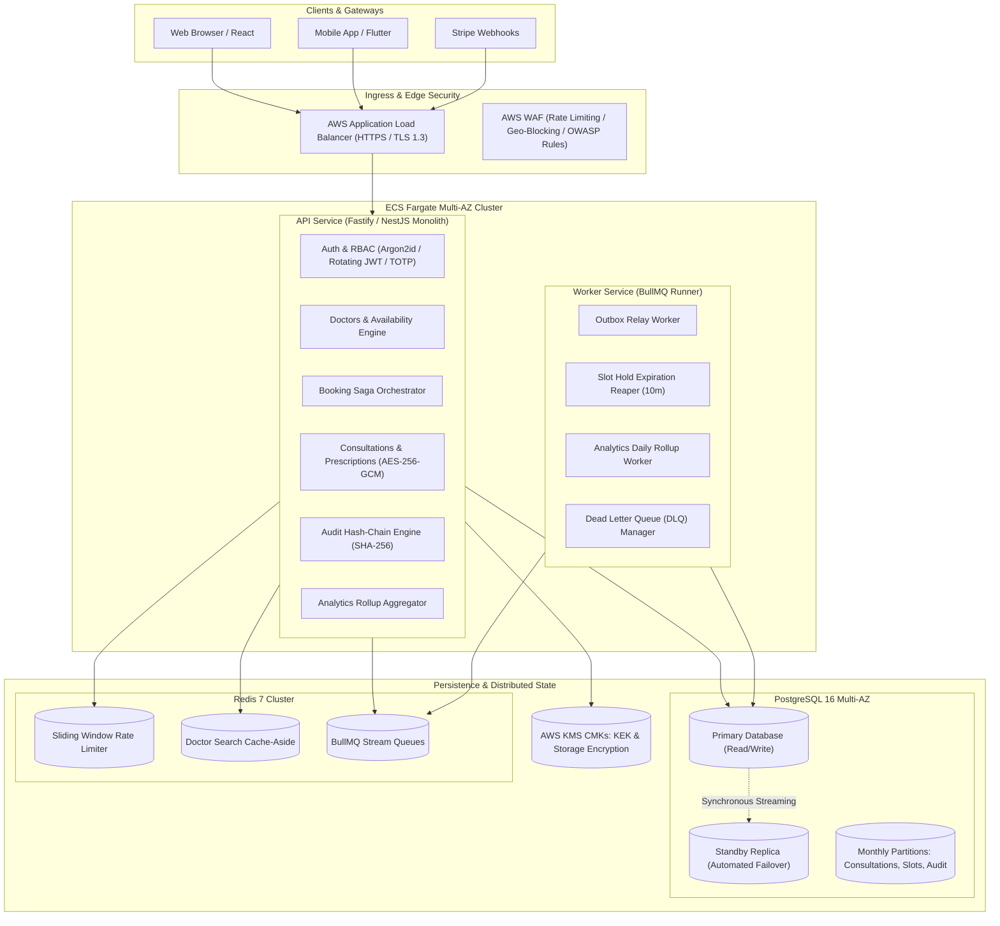
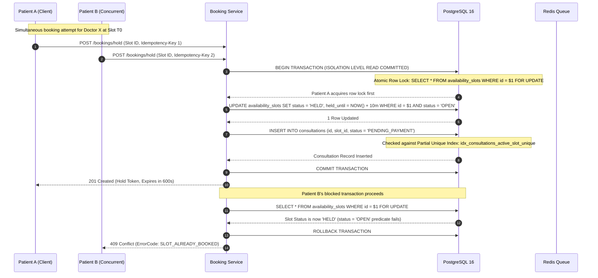
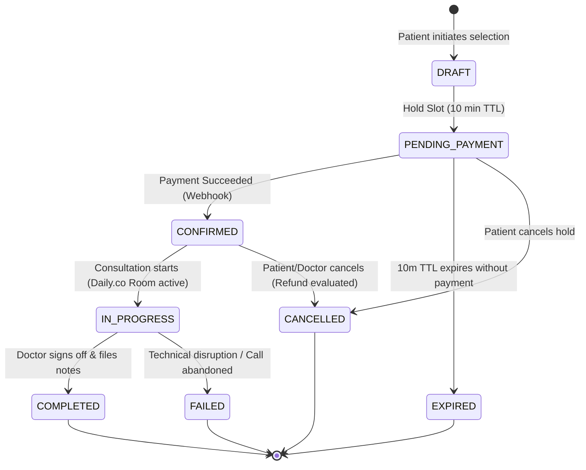
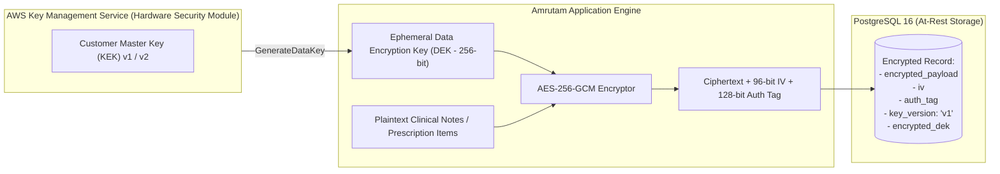
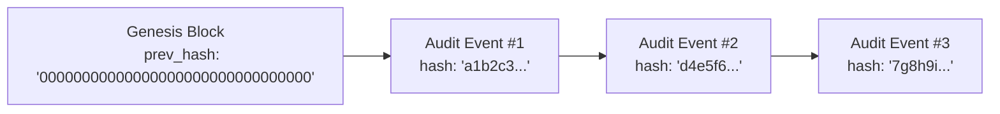

# Amrutam Telemedicine Platform — System Architecture & Engineering Blueprint

---

## 1. System Overview & Component Architecture

The Amrutam Telemedicine Platform is structured as a **modular monolith** with decoupled runtime execution tiers:
1. **API Tier (`src/main.ts`)**: Fastify-backed NestJS HTTP engine serving REST APIs, RFC 7807 problem details, OpenAPI 3.1 documentation, and Prometheus metrics.
2. **Background Worker Tier (`src/worker.ts`)**: Dedicated BullMQ queue consumer processing transactional outbox events, slot hold expirations (10-minute hold reaper), saga reconciliation, and analytical rollups.
3. **Data & State Tier**:
   - **PostgreSQL 16 Multi-AZ**: Relational single source of truth utilizing monthly partition tables, `tstzrange` GiST exclusion constraints, and partial unique indexes.
   - **Redis 7 Cluster**: Distributed cache-aside layer with single-flight stampede suppression, sliding-window rate limiters, and BullMQ task queues.



---

## 2. Concurrency Control & Zero Double-Booking Guarantee

Double-booking represents an auto-fail risk in telemedicine. The Amrutam platform guarantees **zero double-booking** through mathematical defense-in-depth across three architectural layers:



### Database Enforcement Mechanics:
1. **GiST Exclusion Constraint (`tstzrange`)**:
   ```sql
   ALTER TABLE availability_slots ADD CONSTRAINT no_overlapping_slots_per_doctor
   EXCLUDE USING gist (doctor_id WITH =, tstzrange(start_time, end_time) WITH &&);
   ```
   Prevents overlapping time slots for a single doctor even across concurrent slot generation tasks.
2. **Partial Unique Index on Active Consultations**:
   ```sql
   CREATE UNIQUE INDEX idx_consultations_active_slot_unique
   ON consultations (slot_id)
   WHERE status NOT IN ('CANCELLED', 'EXPIRED');
   ```
   Guarantees at the database B-Tree index level that two consultations can never reference the same physical slot unless previous bookings are cancelled or expired.
3. **Pessimistic Row-Level Locking**:
   All booking state mutations execute within `SELECT FOR UPDATE` blocks, serializing concurrent writes without race windows.

---

## 3. Booking Saga & State Machine Architecture

The consultation lifecycle is modeled as a formal deterministic finite-state automaton:



### Saga Compensations & Webhook Replay Deduplication:
- **Transactional Outbox Pattern**: When a slot is held, consultation created, or payment intent generated, domain events are saved to the `outbox_events` table *within the same atomic database transaction*.
- **Payment Deduplication**: Stripe webhooks verify HMAC-SHA256 signatures and insert incoming event IDs into `processed_webhooks` with `ON CONFLICT DO NOTHING`. If a webhook replay occurs, it is immediately acknowledged (HTTP 200) without double-processing.
- **Refund Policy Engine**:
  - Cancellation $> 24\text{ hours}$ before scheduled start: **100% refund**.
  - Cancellation $2 - 24\text{ hours}$ before scheduled start: **50% refund**.
  - Cancellation $< 2\text{ hours}$ before scheduled start: **0% refund (Non-refundable)**.
  - Doctor-initiated cancellation at any time: **100% refund + patient notification**.

---

## 4. Cryptography & Envelope Encryption Architecture

To satisfy HIPAA and GDPR requirements for Protected Health Information (PHI) and Personally Identifiable Information (PII), Amrutam implements **AES-256-GCM Envelope Encryption**:



- **Per-Record Isolation**: A unique DEK is generated for every encrypted prescription and clinical note.
- **Key Versioning**: Every encrypted row stores `key_version`. When the master KEK is rotated annually, existing data remains decryptable, and background jobs re-wrap stored DEKs (`CryptoService.reWrap()`) without touching underlying ciphertexts.
- **Log Leakage Prevention**: Pino logger employs recursive field masking on `notes`, `diagnosis`, `items`, `password`, `ssn`, and `token`.

---

## 5. Audit Log Cryptographic Hash-Chaining

All security-sensitive operations (prescription issuance, clinical note access, admin status modifications, KYC approvals) are recorded in an **immutable, append-only audit ledger**:

$$\text{hash}_n = \text{HMAC-SHA256}\left(\text{hash}_{n-1} \,\|\, \text{timestamp} \,\|\, \text{actor\_id} \,\|\, \text{action} \,\|\, \text{payload}\right)$$



- **Database-Level Immutability**: PostgreSQL `BEFORE UPDATE OR DELETE` triggers unconditionally raise SQL exceptions, preventing any tampering even by database administrators.
- **Verification API**: `GET /api/v1/audit/verify` re-computes the cryptographic chain from genesis to head, immediately detecting any row injection, deletion, or modification.

---

## 6. Observability, Metrics & Multi-Window Burn-Rate Alerting

The platform implements Google SRE multi-window, multi-burn-rate alerting for a **99.95% Availability SLO** ($\approx 21.6\text{ minutes}$ monthly error budget):

| Alert Severity | Burn Rate | 99.95% Budget Consumed | Time Window | Detection Latency | Notification Channel |
|---|---|---|---|---|---|
| **Critical (Page)** | **14.4x** | 2.0% in 1 hour | 1 hour | ~2 minutes | PagerDuty / On-Call Engineer |
| **High (Ticket)** | **6.0x** | 5.0% in 6 hours | 6 hours | ~15 minutes | DevOps Slack Channel |
| **Medium (Log)** | **1.0x** | 10.0% in 3 days | 3 days | ~2 hours | Weekly Engineering Review |

Prometheus RED metrics (`http_requests_total`, `http_request_duration_seconds`), database pool saturation gauges, and BullMQ queue depths are scraped via `/api/v1/metrics` and visualized on provisioned Grafana dashboards.

---

## 7. Disaster Recovery & Backup Runbook

- **RPO (Recovery Point Objective)**: $\le 5\text{ minutes}$ via PostgreSQL Continuous Write-Ahead Log (WAL) archiving and AWS RDS 35-day Point-In-Time-Recovery (PITR).
- **RTO (Recovery Time Objective)**: $\le 30\text{ minutes}$ via automated Terraform infrastructure provisioning and multi-AZ failovers.
- **Cross-Region DR**: Automated daily snapshots copied asynchronously to `ap-southeast-1` (Singapore) with KMS key alias re-encryption.
