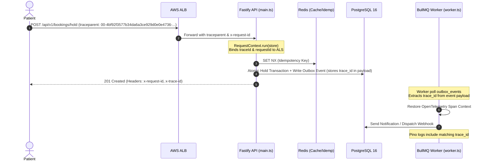

# Distributed Observability, Tracing, and Correlation Architecture

## 1. Overview

The Amrutam Telemedicine Platform implements unified observability across three core telemetry pillars:
1. **Metrics**: Prometheus format RED metrics scraped every 10s from `/metrics`.
2. **Logs**: Structured JSON logs via Pino with automatic redaction of PHI/PII and secrets.
3. **Traces**: OpenTelemetry (W3C TraceContext `traceparent`) propagation across HTTP requests, PostgreSQL queries, Redis commands, and BullMQ worker jobs.

---

## 2. End-to-End Correlation Architecture

Every inbound request is assigned a unique `request_id` and OpenTelemetry `trace_id`. The context is preserved across synchronous and asynchronous execution boundaries using Node.js `AsyncLocalStorage`:



---

## 3. Structured Log Schema with Correlation Fields

All log output is structured JSON formatted as:

```json
{
  "level": 30,
  "time": 1730100000000,
  "pid": 1234,
  "hostname": "amrutam-api-fargate-01",
  "requestId": "0192e100-7000-8000-8000-000000000001",
  "traceId": "4bf92f3577b34da6a3ce929d0e0e4736",
  "actorId": "0192e000-0000-7000-8000-000000000005",
  "actorRole": "PATIENT",
  "msg": "Slot 0192e100-... held successfully for patient",
  "context": "BookingsService"
}
```

Because `traceId` and `requestId` are consistently emitted across the REST API, database queries, and BullMQ worker jobs, an operator in Grafana Loki can filter by `{traceId="4bf92f3577b34da6a3ce929d0e0e4736"}` and immediately see the complete lifecycle of a booking from initial hold to payment confirmation and prescription dispatch.

---

## 4. Observability Stack Integration in Docker Compose

The complete observability stack is defined in `docker-compose.yml`:
- **Prometheus** (`:9090`): Metric collection and alert evaluation.
- **Grafana** (`:3000`): Executive dashboards provisioned as code.
- **Loki** (`:3100`): Log aggregation.
- **Tempo** (`:3200`): Distributed trace backend.
