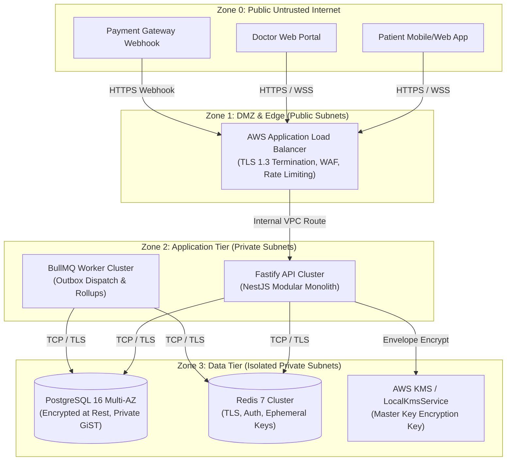

# Comprehensive STRIDE Threat Model & Data Classification

## 1. System Context and Trust Boundaries

The Amrutam Telemedicine Platform processes sensitive Protected Health Information (PHI) and financial transactions across four primary trust zones:

---

## 2. Data Classification Matrix

| Classification Level | Attributes | Storage Mechanism | Retention & De-identification |
|---|---|---|---|
| **Restricted (PHI / Clinical)** | Clinical consultation notes, diagnostic items, medication dosages, instructions. | **AES-256-GCM Envelope Encryption** with per-record DEK. Zero plaintext on disk. | Retained 7 years. Cryptographic shredding upon DEK revocation. Never in logs. |
| **Confidential (PII)** | Patient full name, phone number, date of birth, emergency contact. | Field-level AES-256-GCM in `profiles`. | Erasure supported via `POST /api/v1/audit/anonymize/:userId`. Redacted in logs. |
| **Confidential (Credentials)** | Password hashes, refresh token hashes, TOTP MFA secrets, backup codes. | Argon2id salted hashes; encrypted TOTP secrets. | Revoked on logout or reuse detection. Pruned after 90 days. |
| **Internal (Audit & Ledger)** | Cryptographic audit logs, payment intents, booking state events. | Immutable table `audit_logs` protected by DB trigger and SHA-256 hash-chain. | Permanent retention. Read restricted to `ADMIN` and `AUDITOR`. |
| **Public** | Doctor specialties, verified status, consultation fee, available open slots. | Public PostgreSQL tables, Redis cache-aside. | Real-time availability; non-authoritative caching. |

---

## 3. STRIDE Threat Analysis & Concrete Mitigations

### 3.1. Spoofing (Identity & Authenticity)
- **Threat**: Attacker forges JWT access tokens or impersonates another user.
- **Mitigations**:
  - JWTs signed using strong secrets and short 15-minute expirations.
  - Refresh tokens employ rotating token families with automatic reuse revocation.
  - Mandatory TOTP MFA for privileged roles (`DOCTOR`, `ADMIN`, `AUDITOR`).
  - Webhooks require cryptographic HMAC-SHA256 signature verification with 5-minute timestamp tolerance.

### 3.2. Tampering (Data Integrity)
- **Threat**: Malicious actor alters consultation status, prescription items, or audit records.
- **Mitigations**:
  - State machine assertions guard every consultation status transition (`ConsultationStateMachine`).
  - Prescriptions are strictly append-only; amendments insert new version records.
  - Database triggers permanently block `UPDATE` and `DELETE` on `audit_logs`.
  - SHA-256 hash chaining detects any tampered row, metadata, or broken link.
  - Kysely parameterized queries prevent SQL injection.

### 3.3. Repudiation
- **Threat**: Doctor denies issuing a prescription, or patient denies initiating booking.
- **Mitigations**:
  - Every action recorded in hash-chained `audit_logs` with `actor_id`, `actor_role`, `ip_address`, `request_id`, and `timestamp`.
  - Webhooks logged in `payment_events` with raw payload and provider transaction IDs.

### 3.4. Information Disclosure
- **Threat**: Raw medical notes or patient phone numbers leak in application logs or to unauthorized users.
- **Mitigations**:
  - Automatic recursive redaction in Pino logger (`redaction.util.ts`) scrubs PHI, secrets, and credentials.
  - Administrators and Auditors querying prescriptions receive metadata only; clinical items and instructions are masked as `null`.
  - All PHI/PII encrypted at rest using AES-256-GCM envelope encryption.

### 3.5. Denial of Service (DoS)
- **Threat**: Malicious user reserves hundreds of slots without paying, starving genuine patients.
- **Mitigations**:
  - Atomic 10-minute hold expiration enforced by `reapExpiredHolds` background worker.
  - Sliding-window Redis token bucket rate limiting on write endpoints.
  - Fastify request body limits capped at 1MB and connection timeouts capped at 15s.

### 3.6. Elevation of Privilege
- **Threat**: Regular patient attempts to access `/api/v1/analytics` or `/api/v1/audit/logs`.
- **Mitigations**:
  - Deny-by-default `RolesGuard` paired with `@Roles(...)` metadata.
  - Strict ownership validation in consultation and prescription controllers preventing BOLA/IDOR.

---

## 4. Residual Risk Assessment

| Residual Risk | Probability | Impact | Accepted Justification & Compensating Controls |
|---|---|---|---|
| Master KMS Key Compromise | Extremely Low | Critical | Managed via AWS KMS with CloudTrail auditing and annual automated key rotation. |
| Coordinated Zero-Day in Node/Fastify | Low | High | Dependency audit in CI, non-root Docker container, minimal Alpine base image, and WAF at ALB. |
| In-Memory Dump of Decrypted DEK | Low | Moderate | Ephemeral keys exist only in execution call stacks; garbage collected immediately after crypto operation. |
